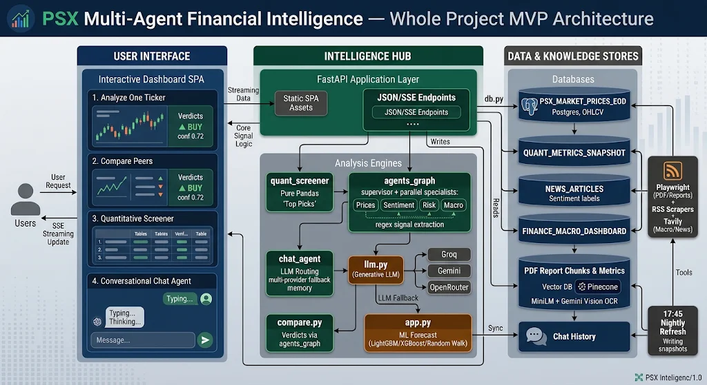

# PSX Financial Intelligence Platform

### Multi-Agent AI Research & Quantitative Decision Support for the Pakistan Stock Exchange

An AI-powered financial intelligence platform designed to transform fragmented financial information into structured, explainable market insights through multi-agent orchestration, Retrieval-Augmented Generation (RAG), and quantitative validation.

## The Business Problem

### Financial Information Is Abundant. Actionable Intelligence Is Not.

Investors researching the Pakistan Stock Exchange often face fragmented financial information spread across quarterly reports, market data, economic indicators, and financial news.

Extracting meaningful insights requires manually reviewing multiple sources, connecting financial indicators, evaluating market sentiment, and assessing investment risks.

Traditional research workflows are time-consuming, while standalone LLM-based solutions introduce another challenge: unreliable outputs, unsupported claims, and hallucinated financial insights.

**The objective:** Build an intelligent research platform that brings these information sources together, automates financial analysis, and combines AI-generated insights with deterministic quantitative validation.

## My Approach

I approached this as an AI engineering and system architecture problem rather than simply building a financial chatbot.

### 1. Multi-Agent Intelligence

Designed a supervisor-based architecture that coordinates five specialized agents:

- **Market Data Agent:** Handles market-related data analysis.
- **Sentiment Agent:** Analyzes financial sentiment.
- **Risk Agent:** Evaluates relevant financial risks.
- **Macroeconomic Agent:** Handles macroeconomic analysis.
- **RAG Agent:** Retrieves relevant information from indexed financial documents.

The supervisor coordinates tasks and combines specialist outputs into a unified response.

### 2. Retrieval-Augmented Generation (RAG)

Built a document-processing pipeline to extract and index financial information from quarterly reports.

**Pipeline:** Playwright → PyMuPDF/OCR → Sentence Transformers → Pinecone

This enables semantic retrieval of relevant financial information instead of relying entirely on an LLM's pretrained knowledge.

### 3. Reliability & Fault Tolerance

Implemented a three-provider LLM fallback architecture:

**Google Gemini → Groq → OpenRouter**

Integrated automatic retries and rate limiting to improve service resilience when providers encounter availability or rate-limit issues.

### 4. Quantitative Validation & Evaluation

Built a lookahead-safe backtesting harness to evaluate AI-generated advisory recommendations against a deterministic, mathematics-based signal engine.

The objective was to prevent unverified LLM outputs from directly driving trading decisions and introduce a measurable validation layer.

## System Architecture

The platform follows a supervisor-based multi-agent architecture with specialized intelligence modules, document retrieval, external LLM providers, and quantitative validation.

<!-- Add your existing architecture diagram below -->

## Tech Stack

| Category | Technologies |
|---|---|
| Language | Python |
| Backend | FastAPI, REST APIs |
| Database | PostgreSQL |
| Vector Database | Pinecone |
| AI & LLMs | Google Gemini, Groq, OpenRouter |
| Agent Architecture | Multi-Agent Orchestration |
| RAG | Sentence Transformers, Embeddings |
| Document Processing | Playwright, PyMuPDF, OCR |
| Frontend | HTML, CSS, Vanilla JavaScript |
| Streaming | Server-Sent Events (SSE) |
| Reliability | Retry Logic, Rate Limiting |
| Evaluation | Quantitative Backtesting |
| Antigravity | AI-Assisted Coding |

## Key Engineering Highlights

- Supervisor-based orchestration of five specialized agents.
- Semantic retrieval over financial documents using vector search.
- Multi-provider LLM fallback architecture.
- Asynchronous market intelligence workflows.
- Real-time response streaming through SSE.
- Lookahead-safe backtesting for recommendation validation.
- Separation of probabilistic AI reasoning from deterministic financial calculations.

## What I Learned

Building this project strengthened my understanding of several important AI engineering concepts:

- Designing multi-agent systems with clear responsibilities and coordination.
- Building RAG pipelines beyond basic document embedding and retrieval.
- Handling LLM provider failures through fallback mechanisms and retry strategies.
- Understanding why financial AI systems require deterministic validation.
- Designing evaluation workflows to measure AI outputs beyond response quality.
- Translating complex AI architectures into usable backend APIs.

One of my biggest takeaways was that building an AI-powered system is not just about getting an LLM to generate an answer. It is about making the entire system reliable, testable, and accountable.

## Video Demonstration

🎥 **Watch the Project Demo:**

[Watch on YouTube](https://youtu.be/mJbJHf-7-Ys)

## Project Purpose

This project was developed as an AI engineering initiative to explore how multi-agent systems, RAG, and quantitative validation can work together to improve financial research workflows.

**Disclaimer:** This platform is an experimental financial research and decision-support project, not a source of guaranteed investment returns or personalized financial advice.

